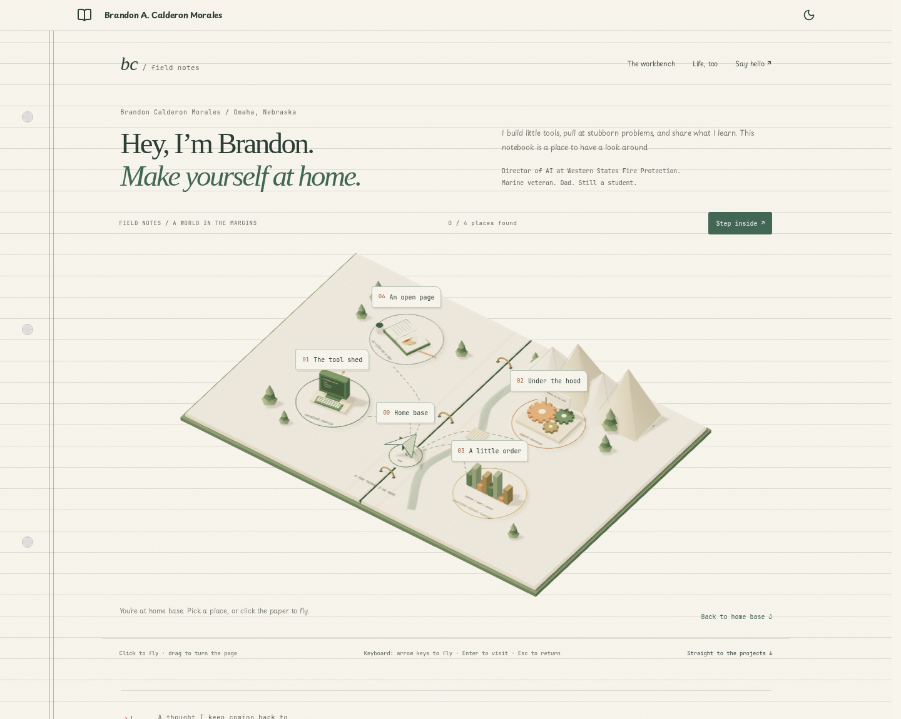

<div align="center">

# My Life as a Dev

**A little world on notebook paper**

[](https://ba-calderonmorales.github.io/my-life-as-a-dev/)
[](https://github.com/BA-CalderonMorales/my-life-as-a-dev/actions)
[](https://opensource.org/licenses/MIT)

</div>



Fly a paper plane between four open-source projects, look inside the coding-agent loop, sort a small skyline, or leave a sketch. The site keeps a readable HTML workbench alongside the Three.js world.

## Install

```bash
git clone https://github.com/BA-CalderonMorales/my-life-as-a-dev.git
cd my-life-as-a-dev
uv venv .venv
make setup
```

Prerequisites: Python 3.14+, [`uv`](https://docs.astral.sh/uv/). Rust/Cargo is
only needed to rebuild `doc-cli` from source.

## Quick Start

```bash
make serve
```

Open `http://localhost:8001/my-life-as-a-dev/`. Click a project in the notebook
or fly the plane with the arrow keys. Drag to turn the notebook, press Enter
to visit the nearest project, and use Escape to return. **Step inside** opens
the larger view; Escape closes it.

The 3D world loads locally and renders on demand. Reduced motion, keyboard
navigation, and the HTML workbench keep the projects available across devices.
The scene modules live in `docs/assets/js/studio-world/`; Three.js and its
license are bundled in `docs/assets/vendor/three/`.

## Commands

Everything runs through one Rust front door, `doc-cli` (wrapped by
`doc-cli.sh`, which rebuilds the binary when its sources change). Commands
work headless (`./doc-cli <command>`) or from the interactive menu
(`./doc-cli.sh`).

| Command | Purpose |
|---|---|
| `serve` | Zensical dev server on :8001 |
| `build` | Build the site with Zensical |
| `kill` | Stop dev servers and free ports 8000/8001 |
| `info` | Project structure and configuration overview |
| `validate` | Validate `zensical.toml` and referenced files |
| `nav-check` | Find markdown pages missing from navigation |
| `bump-version` | Bump the documentation version |
| `deploy [VERSION]` | Deploy a versioned release to GitHub Pages |
| `setup` | Install dependencies and start the server |
| `help` | The full command map |

Make aliases: `make serve`, `make build`, `make test`, `make e2e`,
`make viewport-check`, `make accessibility-check`.

## Layout

```text
docs/                           # published content: one page + 404
docs/assets/css/theme.css       # the whole design: notebook paper, typewriter
docs-archive/                   # retired sections, kept on disk
config/zensical/                # modular config, merged into zensical.toml
scripts/rust/                   # doc-cli: the Rust front door
scripts/python/                 # config merge + versioned deploy
e2e/                            # Playwright browser suite
tests/                          # unit contracts
```

`zensical.toml` is generated from `config/zensical/*.toml` before every
serve/build. Retired sections live in `docs-archive/` — restoring one is a
move and a nav entry, not a rewrite.

For notebook screenshots with explicit palette checks and still drawings:

```bash
make build
NOTEBOOK_SCREENSHOT_DIR=/tmp/notebook-preview uv run pytest e2e/quality/test_notebook.py
```

## License

MIT
