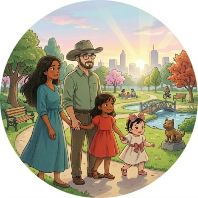

<nav class="studio-masthead" aria-label="Around the studio"><a class="studio-wordmark" href="#studio">bc / field notes</a>
<a href="#building">The workbench</a><a href="#beyond-work">Life, too</a><a href="#connect">Say hello ↗</a>
</nav>
<section class="studio-hero studio-hero-world" aria-labelledby="brandon-calderon-morales">

Brandon Calderon Morales / Omaha, Nebraska
<h1 id="brandon-calderon-morales">Hey, I’m Brandon. <em>Make yourself at home.</em></h1>

I build little tools, pull at stubborn problems, and share what I learn. This notebook is a place to have a look around.

Director of AI at Western States Fire Protection. Marine veteran. Dad. Still a student.

FIELD NOTES / A WORLD IN THE MARGINS0 / 4 places found<button type="button" data-world-immersive>Step inside ↗</button>

Explore the projects below, or open the notebook in 3D.

<h3></h3>

<button class="studio-button" type="button" data-world-sort hidden>Put the skyline in order</button><button class="studio-text-button" type="button" data-world-notes>Open the field notes ↓</button>

Pick a place to explore. The workbench below is always open, too.
<button type="button" data-world-reset>Back to home base ↺</button>

Click to fly · drag to turn the pageKeyboard: arrow keys to fly · Enter to visit · Esc to return<a href="#building">Straight to the projects ↓</a>

</section>
<section class="studio-belief" aria-labelledby="human-first"><svg viewBox="0 0 40 40"><path d="M20 3v34M3 20h34M8 8l24 24M8 32 32 8"/></svg>
A thought I keep coming back to<h2 id="human-first">AI should work for humans, <em>not the other way around.</em></h2>

That’s how I approach the work: start with the people doing it. Find out what’s getting in their way. Build something that helps.
</section>
<section class="studio-projects" aria-labelledby="building">

01 / Things I’m building
<h2 id="building">Welcome to the workbench.</h2>

Pick something up. See what makes it tick.

01 / The tool shedPick it up. See what happens.

<svg viewBox="0 0 340 220"><path d="M80 35h180v115H80zM93 48h154v87H93zM155 150v20m30-20v20M125 170h90M66 180h210l15 25H50zM105 65l12 10-12 10m23 0h35"/></svg>

Choose a project to take a closer look.

<button type="button" data-bench-turn>Turn it ↻</button><button type="button" data-bench-reset>Set it down</button><button type="button" data-bench-draw aria-pressed="false" hidden>Pick up the pencil</button>

<nav class="studio-project-list" aria-label="Project experiments">
<a class="studio-project-choice" href="#exhibit-jarvis" data-project="jarvis">01<strong>terminal-jarvis</strong><small>A home for your coding tools</small>Rust · developer tools↗</a>
<a class="studio-project-choice" href="#exhibit-agent" data-project="agent">02<strong>agent-harness</strong><small>Open the hood on a coding agent</small>Go · learning by building↗</a>
<a class="studio-project-choice" href="#exhibit-algorithm" data-project="algorithm">03<strong>algorithm-visual-learning</strong><small>A little less abstract. A lot more visible.</small>TypeScript · interactive learning↗</a>
<a class="studio-project-choice" href="#exhibit-notebook" data-project="notebook">04<strong>my-life-as-a-dev</strong><small>This little corner of the internet</small>JavaScript · always in progress↗</a>

<svg viewBox="0 0 100 45" aria-hidden="true"><path d="M8 10Q38 42 80 14m-12-2 14-1-5 13"/></svg>Take your time. Try a few things.

</nav>

<noscript>
The interactive sketches need JavaScript. You can still explore every project and its source below.
</noscript>
<section class="studio-exhibit" id="exhibit-jarvis" aria-labelledby="jarvis-title">

01 / terminal-jarvisInteractive sketch
<h3 id="jarvis-title">So many tools. One place to start.</h3>
I wanted an easier way to try the coding tools I kept hearing about. So I built one.

● ● ●the tool shed

$ terminal-jarvis
What are you curious about today?

<button type="button" data-tool="codex">Codex</button><button type="button" data-tool="claude">Claude Code</button><button type="button" data-tool="gemini">Gemini CLI</button>

Choose a tool to look inside the shed.

A small browser sketch of the idea. Nothing is installed or run.
<a class="studio-source" href="https://github.com/BA-CalderonMorales/terminal-jarvis">Explore terminal-jarvis on GitHub ↗</a>
</section>
<section class="studio-exhibit" id="exhibit-agent" aria-labelledby="agent-title">

02 / agent-harnessInteractive sketch
<h3 id="agent-title">You get to see the gears turn.</h3>
I’m learning how coding agents work by building one in Go. Here’s a tiny version of the loop, with you at the controls.

Ask→Plan→Review→Try

You: “Help me understand this failing test.”

<button class="studio-button" type="button" data-agent-next>Make a plan</button><button class="studio-button" type="button" data-agent-stop hidden>Ask for a different plan</button><button class="studio-text-button" type="button" data-agent-reset>Start over</button>

An illustrative walkthrough. No model calls, files, or commands.
<a class="studio-source" href="https://github.com/BA-CalderonMorales/agent-harness">Explore agent-harness on GitHub ↗</a>
</section>
<section class="studio-exhibit" id="exhibit-algorithm" aria-labelledby="algorithm-title">

03 / algorithm-visual-learningTry it here
<h3 id="algorithm-title">Sometimes you need to see it.</h3>
Watching the steps can make an algorithm easier to understand. Take this one a step at a time.

73826415

Bubble sort compares neighbors and swaps them if they’re out of order.

<button class="studio-button" type="button" data-sort-step>Next comparison</button><button class="studio-button" type="button" data-sort-play>Play it through</button><button class="studio-text-button" type="button" data-sort-shuffle>Shuffle</button>

<a class="studio-source" href="https://github.com/BA-CalderonMorales/algorithm-visual-learning">Explore algorithm-visual-learning on GitHub ↗</a>
</section>
<section class="studio-exhibit" id="exhibit-notebook" aria-labelledby="notebook-title">

04 / my-life-as-a-devMake yourself at home
<h3 id="notebook-title">A website I can keep scribbling in.</h3>
This is where the projects, family, and half-finished ideas meet. Try a different ink. Leave a little mark.

<button type="button" data-ink="pine" aria-pressed="true">Pine</button><button type="button" data-ink="clay" aria-pressed="false">Clay</button><button type="button" data-ink="blue" aria-pressed="false">Blue</button>
<svg class="studio-sketchpad" viewBox="0 0 500 160" role="img" aria-label="Your temporary sketch"><text x="250" y="85" text-anchor="middle">Draw something, or leave a star below.</text></svg>
<button class="studio-button" type="button" data-mark-star>Leave a star</button><button class="studio-text-button" type="button" data-mark-clear>Fresh page</button>

Your sketch stays in this tab until you refresh.

<a class="studio-source" href="https://github.com/BA-CalderonMorales/my-life-as-a-dev">Explore the source of this site ↗</a>
</section>

Four projects. Follow whatever catches your eye.

</section>
<section class="studio-life" aria-labelledby="beyond-work"><figure class="studio-family"><figcaption>The good stuff.</figcaption></figure>

02 / Away from the keyboard
<h2 id="beyond-work">There’s a whole life around the work.</h2>
My wife, our two kids, and the extended fam. Little terminal tools. Kaggle and undergrad at night. I’m still figuring things out, and I like being a student.

Nebraska is home. I’ve taken the long way around: across the States, over to Spain, Germany, and Gibraltar, and back to the Midwest.

<svg class="doodle-plane" viewBox="0 0 700 34" aria-hidden="true"><path d="M6 22C160 0 320 35 540 16L680 5 655 30 651 17 680 5"/></svg>
Observe, learn, apply, share. Repeat.
</section>
<section class="studio-contact" aria-labelledby="connect">
03 / Pull up a chair
<h2 id="connect">Always happy to chat.</h2>
If you’d like to understand how I make AI work for people in organizations, reach out. Or bring a stubborn problem, a little tool, or something to teach me.
<a class="studio-primary" href="mailto:b.dev.c.m@gmail.com">Email me ↗</a>
<a href="https://github.com/BA-CalderonMorales">GitHub</a><a href="https://www.linkedin.com/in/bcalderonmorales-cmoe/">LinkedIn</a><a href="https://www.kaggle.com/bmoe640">Kaggle</a>
<svg viewBox="0 0 100 100"><path d="M24 40h46v29q-23 25-46 0Zm46 4h8q20 12-6 22M17 84h63M35 28q-8-8 0-16m14 16q-8-8 0-16m14 16q-8-8 0-16"/></svg></section>

Made with curiosity in Omaha. Still a work in progress.

